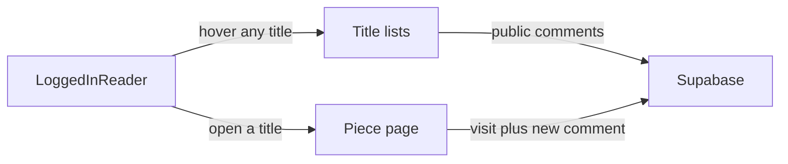

# Reader login, seen list, and comments

Add email login on the existing static site so a reader picks a nickname, opens poems, stories, and notes, keeps a list of what they opened, and comments either privately (reader and you) or publicly for other logged-in readers, who see those comments when hovering a title.

This is the plan. It is not built yet.

The library stays as it is: title lists are public, and choosing a title opens that piece for the reader (`src/pages/translations/[slug].astro`, `src/pages/stories/[slug].astro`, `src/pages/notes/[slug].astro`). GitHub Pages already sends those pages to anyone with the link, so login will not hide the text. It will remember the visit and attach comments.

Accounts, the seen list, and comments live in [Supabase](https://supabase.com) (hosted Postgres + email login). The Astro site stays static. The contact-page Cusdis widget stays for general messages.

## What the reader sees

- **כניסה**: email only. Supabase sends a one-time link. No password. The first time they arrive, they choose a **nickname** (required, up to 40 characters). That nickname is what other logged-in readers see on their public comments. The email is never shown.
- **Hover on a title**: on the translation, story, and note indexes, a logged-in reader can hover any title and see that piece’s public comments (nickname and text), whether or not they have opened it. The comments are the lure to click through. Titles with no public comments show nothing. Visitors who are not logged in see no comments.
- **On a touch screen**, hovering does not exist: a small mark on titles that have public comments opens the same preview. The title itself still navigates to the piece.
- **On a piece**, if they are logged in, the visit is saved (first time and last time). If they are not, the text still opens, with a short line inviting them to log in so the visit is remembered and they can comment. The piece page is where they write, and where they read the full public thread plus their own private notes.
- **תגובה**: one box and a choice — **לכולם** (other logged-in readers, including on the title hover) or **הערה פרטית** (that reader and you; never on the hover). They can delete their own comment. You can delete any comment.
- **מה ראיתי**: their poems, stories, and notes, newest visit first, with links back. Index pages mark titles they already opened. The hover does not depend on that mark.
- **הערות פרטיות** (only you): private notes across the library, with the reader’s nickname and a link to the piece.

## Data

New `supabase/schema.sql`, run once in the Supabase SQL editor. Replace the owner email placeholder with yours before running.

- `profiles` — id, nickname. Created on first sign-in, after they choose the nickname.
- `reads` — user, kind (`poem` | `story` | `note`), slug, title, first and last seen. A reader can read and write only their own rows.
- `comments` — user, kind, slug, body (max 2000 characters), `public` or `private`, time. Public rows are joined to `profiles.nickname` for display.
- `is_owner()` — true only when the logged-in email matches the owner row in a private table.

Row rules:

- `public` comments are readable only by a logged-in user. Anonymous visitors cannot read them.
- A `private` comment is readable by its author and by you. It is never included in the title hover.
- Inserts require a logged-in user with a nickname, and the row’s user id must be theirs.
- Delete is allowed for the author or for you.

The index page loads one query for that section (`poem`, `story`, or `note`) after login, then shows the matching comments on hover. Opening the piece is not required for that query.

## Site code

Add `@supabase/supabase-js`. Browser-only client in `src/lib/supabase.ts` using `PUBLIC_SUPABASE_URL` and `PUBLIC_SUPABASE_ANON_KEY`. If those are missing, the new UI shows a short setup note and the rest of the site still builds (same pattern as Cusdis in `src/config/contact.ts`).

- `src/components/Nav.astro` and `src/layouts/BaseLayout.astro`: כניסה, or the nickname, יציאה, and מה ראיתי. Your extra link appears only after `is_owner()` is true.
- `src/pages/login.astro`: request the link; on return, if they have no nickname yet, ask for one before sending them back to the page they came from.
- `src/components/PieceEngagement.astro`: on each piece page. Records the visit, lists comments, and posts a new one. A small script, no React.
- `src/components/CommentHover.astro` (or the same script on the indexes): after login, attach a preview to every title in `src/pages/translations/index.astro`, `src/pages/stories/index.astro`, and `src/pages/notes/index.astro`. Each title gets `data-piece`. The preview is a literary popover (nickname, comment text), not a browser tooltip. Also mark נראה when that title is in their seen list.
- `src/pages/seen.astro`: the seen list, filled in the browser.
- `src/pages/inbox.astro`: your private notes. Anyone else gets an empty list from the database rules.
- Styles in `src/styles/literary.css`, Hebrew and RTL, in the existing literary type.

Build-time catalog is not required: the seen row stores the title at the moment they open the piece.

## What you set up once

- Create a Supabase project, enable email login, and add redirect URLs for `http://127.0.0.1:4321/Chanans-literary-site/login/` and `https://chanankub.github.io/Chanans-literary-site/login/`.
- Run the schema with your email as owner.
- Put the URL and anon key in `.env` (see `.env.example`) and in GitHub Actions secrets. Pass them in `.github/workflows/deploy.yml` the same way Cusdis is passed today. The anon key is public by design; the service-role key is never used and never committed.
- Short setup notes in `DEPLOY.md`.

## Check after it is built

- First login asks for a nickname.
- Hovering a title the reader has not opened shows its public comments with nicknames.
- Logged out, those comments are absent.
- Opening a poem records it under מה ראיתי.
- A private comment stays off the hover and off the public thread.

Full email delivery depends on the Supabase project being created.
